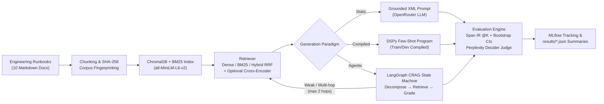

# rag-eval-harness

[](https://github.com/adityavsb/rag-eval-harness/actions/workflows/ci.yml)
[](pyproject.toml)
[](LICENSE)

**Evaluation harness for engineering-runbook RAG — comparing chunking, BM25 + dense hybrid search, cross-encoder reranking, DSPy prompt compilation, and LangGraph Corrective RAG with statistical rigor and live LLM-as-a-Judge scoring.**

[Business Problem](#the-business-problem) · [Key Findings](#key-findings) · [Architecture](#architecture) · [Benchmarks](#benchmarks) · [Quickstart](#quickstart) · [ADRs](docs/decisions.md)

---

## The Business Problem

Platform, SRE, and security teams maintain critical operational knowledge across markdown runbooks (gateway routing, JWT lifetimes, rate limits, failover thresholds, canary rollbacks). When leadership asks for an internal **"Ask the Runbooks"** assistant for onboarding and 3 a.m. incident response, shipping a quick RAG demo is easy—**proving it is safe is hard**:

- **Operational risk, not just bad UX:** Hallucinating a token TTL or rollback threshold causes outages. The assistant must cite internal documentation and **explicitly refuse** when the runbooks are silent.
- **Entangled design choices:** Outcomes depend on chunk boundaries, hybrid lexical/vector retrieval, reranking latency, prompt optimization, and whether cross-document questions justify an agentic second hop. Without a frozen benchmark, teams ship changes on vibes or misleading retrieval percentages.

`rag-eval-harness` is the evaluation spine for that decision: a curated fictional enterprise runbook corpus (10 docs, 80 stratified Q&A pairs: 44 single-hop factoids, 17 multi-hop synthesis, 19 adversarial negatives), deterministic span-based IR metrics with **2,000-resample bootstrap CIs**, **MLflow** tracking, and live **OpenRouter** generation scored under a single external judge (**Perplexity Decider** via `/api/alpha/decisions`).

**Core stack:** Python · Pydantic · ChromaDB · `sentence-transformers` (MiniLM bi-encoder & cross-encoder) · `rank-bm25` · LangGraph · DSPy · LiteLLM / OpenRouter · MLflow · Pytest · GitHub Actions

---

## Key Findings

1. **Chunk-ID labels and mixed denominators silently corrupt RAG benchmarks:** Early runs scored 1,000-char chunks against 400-char chunk IDs, making the naive baseline look like 12.5% Hit@4 when span-overlap matching showed 98.36% (by returning ~20% of the corpus per query). Separating **n = 61** answerable queries from **n = 19** adversarial negatives keeps IR metrics clean while tracking **negative refusal rate** explicitly.
2. **Small-n retrieval gains need confidence intervals, not point estimates:** Cross-encoder reranking (`ms-marco-MiniLM-L6-v2`) adds **~13× P95 retrieval latency** (4.4 ms → 59.7 ms) for a **+0.011 MRR** shift whose paired 95% CI spans zero (`[-0.042, +0.066]`). BM25 + dense RRF preserves ~4.7 ms latency while adding exact lexical matching.
3. **Naive `max_tokens` caps silently break reasoning-model benchmarks:** Running `deepseek/deepseek-v4.1-flash` and `qwen/qwen3.7-flash` at `max_tokens: 500` starved their internal reasoning traces and emitted empty strings (`""`) on 11/80 DeepSeek and 51/80 Qwen queries—falsely making Qwen look like a 31.6%-refusal hallucinator. Raising the cap to `4000` eliminated all empty outputs (`0/80`), restoring **100% refusal** and **84.3% correctness** on Qwen and revealing the real trade-off: nearly identical accuracy (~84%) at **2.9× slower P95 latency** (17.4 s vs 6.0 s).
4. **LangGraph Corrective RAG lifts accuracy at a 2.1× latency bill:** On identical `deepseek-v4.1-flash` + Perplexity Decider scoring (`max_tokens: 4000`), bounded 2-hop query decomposition and relevance grading raised overall correctness from **83.8% → 86.5%** (paired 95% CI **`[+0.09 pp, +6.07 pp]`**), multi-hop correctness **66.7% → 71.1%**, and multi-hop recall **59.8% → 63.7%**, while doubling P95 generation latency (**6.0 s → 12.5 s**). In production, this favors routing simple lookups to fast single-shot hybrid RAG and invoking the agentic graph only for compound queries.
5. **Offline mocks are for wiring; prompt compilation needs quarantined holdouts:** An early mock LM heuristic (`OfflineRAGLM`) produced a fake +53.9% "DSPy gain." Under live OpenRouter compilation on `train`/`dev` and scoring only on the quarantined 32-item `test` split, 4-demo DSPy compilation produced a realistic **+0.5 pp** overall (+2.5 pp multi-hop) lift over an already well-specified zero-shot prompt.

---

## Architecture



Design rationale and trade-offs (ChromaDB vs. hosted vector DBs, span-overlap matching, RRF vs. cross-encoder, reasoning token budgets, judge isolation) are documented in [docs/decisions.md](docs/decisions.md).

---

## Benchmarks

Every number below is backed 1:1 by committed aggregate JSON under [`results/`](results/). Full per-query traces stay local under [`reports/`](reports/) (gitignored); see [`results/live_run_lineage.json`](results/live_run_lineage.json) for provenance and superseded runs.

### 1. Offline Retrieval Sweep (`n = 61` answerable, `B = 2,000` bootstrap CIs)

> [!NOTE]
> **Offline mode disclosure:** Retrieval numbers below use real local models (`all-MiniLM-L6-v2`, BM25, `cross-encoder/ms-marco-MiniLM-L6-v2`) with span-overlap matching (≥50%). In `--mode offline`, generation is a **deterministic mock** echoing the top chunk and the judge is a **lexical-overlap heuristic**—used only for fast, zero-cost CI regression testing, never as evidence about any LLM.

| Metric (@K = 4) | Baseline Fixed (1000/0) | Recursive (400/50) | Dense + Cross-Encoder | Hybrid RRF (BM25 + Dense) | Hybrid RRF + Cross-Encoder | Δ Hybrid vs. Recursive (95% CI) |
| :--- | :---: | :---: | :---: | :---: | :---: | :---: |
| **Hit Rate@4** | 98.36% [95.08%, 100.0%] | 73.77% [62.30%, 83.61%] | 73.77% [62.30%, 83.61%] | 72.13% [60.66%, 83.61%] | 73.77% [62.30%, 83.61%] | -1.64% [-4.92%, 0.00%] (McNemar p = 1.00) |
| **MRR@4** | 0.906 [0.848, 0.959] | 0.643 [0.529, 0.750] | 0.654 [0.542, 0.761] | 0.650 [0.536, 0.757] | 0.654 [0.542, 0.761] | +0.007 [-0.014, 0.033] |
| **Context Precision@4** | 90.16% [84.43%, 95.22%] | 63.39% [52.19%, 74.04%] | 64.16% [53.14%, 74.41%] | 63.93% [52.60%, 74.46%] | 64.16% [53.14%, 74.41%] | +0.55% [-1.91%, 3.42%] |
| **Context Recall@4** | 94.26% [89.07%, 98.36%] | 63.11% [52.19%, 73.50%] | 65.57% [54.37%, 75.96%] | 63.39% [52.46%, 74.04%] | 65.57% [54.37%, 75.96%] | +0.27% [-1.64%, 2.46%] |
| **P95 Latency** | 5.5 ms | 4.4 ms | 59.7 ms | 4.7 ms | 59.9 ms | +0.3 ms |

*Fixed-K context volume note:* At `K = 4`, fixed 1000/0 returns 4,000 chars (~20% of the 10-doc corpus across 21 chunks), inflating span hit rate at a **2.5× prompt-token penalty** vs. recursive 400/50 (1,600 chars / 6% of corpus across 65 chunks). Source: [`results/offline_retrieval_summary.json`](results/offline_retrieval_summary.json).

### 2. Live Generator Cohort (Fixed Hybrid RRF, Perplexity Decider Judge)

Both generators receive the exact same Hybrid RRF Top-4 context (`index_fingerprint: aab84d8b…`, `max_tokens: 4000`, `0/80` empty outputs) and are scored by `perplexity/pplx-decider-flash-v1.2` via OpenRouter `/api/alpha/decisions`. Generation quality is averaged over `n = 61` answerable queries; negative refusal over `n = 19` adversarial negatives. Source: [`results/openrouter_cohort_summary.json`](results/openrouter_cohort_summary.json).

| Generator | Factoid Corr. (`n=44`) | Multi-Hop Corr. (`n=17`) | Neg. Refusal (`n=19`) | Mean Faith. (`n=61`) | Mean Corr. (`n=61`) | Rubric (1–5) | P95 Gen Latency |
| :--- | :---: | :---: | :---: | :---: | :---: | :---: | :---: |
| `deepseek/deepseek-v4.1-flash` | 90.4% | 66.7% | 100.0% | 97.3% | 83.8% | 4.46 | 5,995 ms |
| `qwen/qwen3.7-flash` | 90.5% | 68.2% | 100.0% | 97.3% | 84.3% | 4.46 | 17,429 ms |

### 3. Live Paradigm Comparison: Static Hybrid RRF vs. LangGraph Agentic CRAG

Apples-to-apples comparison on identical generator (`deepseek/deepseek-v4.1-flash`, `max_tokens: 4000`), retriever index, and Perplexity Decider judge (`0/80` empty outputs). Sources: [`results/openrouter_cohort_summary.json`](results/openrouter_cohort_summary.json), [`results/agentic_crag_summary.json`](results/agentic_crag_summary.json), [`results/paradigm_comparison.md`](results/paradigm_comparison.md).

| Paradigm | Factoid Corr. (`n=44`) | Multi-Hop Corr. (`n=17`) | All-Hops MH Recall | Neg. Refusal (`n=19`) | Mean Faith. (`n=61`) | Mean Corr. (`n=61`) | P95 Gen Latency |
| :--- | :---: | :---: | :---: | :---: | :---: | :---: | :---: |
| **Static Hybrid RRF** | 90.4% | 66.7% (3.76/5) | 59.8% | 100.0% | 97.3% | 83.8% (4.46/5) | 5,995 ms |
| **LangGraph Agentic CRAG** | 92.5% | 71.1% (3.94/5) | 63.7% | 100.0% | 97.6% | 86.5% (4.57/5) | 12,475 ms |
| **Paired Δ (95% Bootstrap CI)** | +2.1 pp `[-0.2, +5.9]` | +4.3 pp `[-1.2, +10.7]` | +3.9 pp | 0.0 pp | +0.3 pp | **+2.7 pp `[+0.1, +6.1]`** | +6,480 ms (2.1×) |

### 4. Quarantined DSPy Prompt Optimization (`n = 32` test split)

`src/optimize/compile.py` compiles `RAGModule` with `BootstrapFewShotWithRandomSearch` strictly on `train` (32) / `dev` (16) and evaluates out-of-sample on the quarantined `test` split (32 items: 16 factoid, 8 multi-hop, 8 adversarial) using `deepseek/deepseek-v4.1-flash` (`max_tokens: 4000`) and Perplexity Decider. Source: [`results/dspy_openrouter_summary.json`](results/dspy_openrouter_summary.json).

| Arm (Retrieved Hybrid Top-4) | Mean Correctness | Multi-Hop Correctness (`n=8`) | Negative Refusal (`n=8`) | Mean Faithfulness |
| :--- | :---: | :---: | :---: | :---: |
| Zero-shot signature | 81.5% | 53.2% | 100.0% | 95.8% |
| Compiled (4 demonstrations) | 82.0% | 55.7% | 100.0% | 96.8% |

<details>
<summary><strong>Offline Heuristic Judge Regression Guard &amp; Benchmark Environment</strong></summary>

#### Offline Heuristic Judge Calibration (In-Sample Probe Guard Only)
The offline lexical heuristic (`LLMJudge._offline_faithfulness`, `_offline_correctness`) is checked against 30 author-written probe labels in [`data/human_labels.jsonl`](data/human_labels.jsonl) strictly as a CI regression guard—not as independent multi-annotator calibration for live models:

| Calibration Metric | Observed | 95% CI | Reference Band |
| :--- | :---: | :---: | :--- |
| Evaluated Samples | 30 | — | Single-annotator probe set |
| Faithfulness Raw Agreement | 83.3% | — | ≥ 80.0% |
| Faithfulness Cohen's κ | 0.667 | `[0.40, 0.93]` | Substantial (Landis & Koch 1977) |
| Correctness Spearman ρ | 0.872 | `[0.77, 0.93]` | `p = 3.69 × 10⁻¹⁰` |

#### Benchmark Environment (Apple Silicon arm64)
Captured automatically into every report (`environment` key; see [`results/offline_retrieval_summary.json`](results/offline_retrieval_summary.json)):
- **Platform:** `macOS-27.0.1-arm64`, Python `3.13.6`
- **Key pins:** `chromadb 1.5.9`, `sentence-transformers 6.1.0`, `langgraph 1.2.16`, `dspy 3.4.1`, `mlflow 3.17.2`, `rank-bm25 0.2.2`, `torch 2.14.1`, `scipy 1.18.1`, `pydantic 2.14.1`

</details>

---

## Quickstart

### 1. Install & Test (No API Key Required)
```bash
git clone https://github.com/adityavsb/rag-eval-harness.git
cd rag-eval-harness
make install
make test
```
All **66 unit tests** pass offline (~14 s warm; ~40 s cold with model download).

### 2. Offline Retrieval Benchmarks & Interactive Querying
```bash
# Run all 5 retrieval configs (baseline, recursive, rerank, hybrid RRF, hybrid + rerank)
make eval-all

# Export refreshed aggregate JSON to results/offline_retrieval_summary.json
.venv/bin/python scripts/generate_paradigm_table.py --export-offline

# Paired bootstrap CI + exact McNemar test between any two local reports
.venv/bin/python scripts/compare_runs.py \
  reports/offline/chunk-optimized-rag/latest.json \
  reports/offline/hybrid-rrf-rag/latest.json --markdown

# Interactive ad-hoc query CLI (works with static or agentic configs)
.venv/bin/python experiments/run_pipeline.py --config configs/hybrid.yaml \
  --query "What is the token expiration period for short-lived access tokens?"
```

### 3. Live Evaluation (OpenRouter + Perplexity Decider)
Add `OPENROUTER_API_KEY=...` to a local `.env` file at the repo root (gitignored; loaded by `src/utils/config.load_dotenv`):
```bash
# Stage 1 smoke check (1 query, generator only)
.venv/bin/python experiments/run_eval.py --config configs/openrouter_cohort.yaml --mode live --stage check-one

# Full 80-query sweeps (Static Hybrid RRF vs. LangGraph Agentic CRAG)
.venv/bin/python experiments/run_eval.py --config configs/openrouter_cohort.yaml --mode live --stage full --model deepseek/deepseek-v4.1-flash
.venv/bin/python experiments/run_eval.py --config configs/agentic_crag.yaml --mode live --stage full --model deepseek/deepseek-v4.1-flash

# Live DSPy compile on train/dev, then holdout evaluation on quarantined test split
.venv/bin/python src/optimize/compile.py --mode live --model deepseek/deepseek-v4.1-flash
.venv/bin/python src/optimize/compile.py --mode live --eval-only --model deepseek/deepseek-v4.1-flash

# Inspect runs locally in MLflow UI (http://localhost:5001)
make mlflow
```

---

## Repository Layout

```text
rag-eval-harness/
├── configs/                       # Declarative YAML configs (baseline, chunk, rerank, hybrid, agentic_crag, dspy_live, openrouter_cohort)
├── data/
│   ├── raw/                       # 10 authored runbooks (fictional Enterprise API Platform)
│   ├── golden_qa.json             # 80 verified QA pairs with char spans & train/dev/test splits
│   ├── human_labels.jsonl         # 30 author-written probe labels for offline judge guard
│   └── README.md                  # Dataset card, provenance & split quarantine rules
├── docs/
│   └── decisions.md               # Architecture Decision Records (ADRs 001–006)
├── results/                       # Canonical aggregate metrics (committed; backs README tables)
│   ├── offline_retrieval_summary.json
│   ├── openrouter_cohort_summary.json
│   ├── agentic_crag_summary.json
│   ├── dspy_openrouter_summary.json
│   ├── live_run_lineage.json
│   └── paradigm_comparison.md
├── reports/                       # Full per-query JSON traces (local only, gitignored; see reports/README.md)
├── src/
│   ├── pipeline/                  # ingestion, indexing, retriever (dense/BM25/RRF/rerank), generator, agentic_graph (LangGraph)
│   ├── eval/                      # retrieval_metrics, llm_judge (Perplexity Decider + offline guard), judge_agreement, runner
│   ├── llm/                       # provider (LiteLLM + OpenRouter decisions), cache (SHA-256 disk cache), pricing
│   ├── optimize/                  # dspy_program, compile (BootstrapFewShotWithRandomSearch)
│   └── utils/                     # config (Pydantic), tracking (MLflow), release_metadata
├── experiments/                   # CLI entrypoints: run_eval.py, run_pipeline.py
├── scripts/                       # compare_runs, generate_paradigm_table, rejudge_saved_reports, dataset_card, hash_local_reports, list_free_models, migrate_gold_to_spans
└── tests/                         # 66 unit tests (offline deterministic, CI on Python 3.11–3.13)
```

---

## References

- Cormack, G. V., Clarke, C. L. A., & Büttcher, S. (2009). Reciprocal rank fusion outperforms Condorcet and individual rank learning methods. *SIGIR 2009*. https://doi.org/10.1145/1571941.1572114
- Robertson, S., & Zaragoza, H. (2009). The Probabilistic Relevance Framework: BM25 and Beyond. *Foundations and Trends in Information Retrieval*, 3(4). https://doi.org/10.1561/1500000019
- Reimers, N., & Gurevych, I. (2019). Sentence-BERT: Sentence Embeddings using Siamese BERT-Networks. *EMNLP-IJCNLP 2019*. https://doi.org/10.18653/v1/D19-1410
- Khattab, O., et al. (2023). DSPy: Compiling Declarative Language Model Calls into Self-Improving Pipelines. arXiv:2310.03714.
- Es, S., James, J., Espinosa-Anke, L., & Schockaert, S. (2024). RAGAs: Automated Evaluation of Retrieval Augmented Generation. *EACL 2024*. https://doi.org/10.18653/v1/2024.eacl-demo.16
- Cohen, J. (1960). A Coefficient of Agreement for Nominal Scales. *Educational and Psychological Measurement*, 20(1). https://doi.org/10.1177/001316446002000104
- Landis, J. R., & Koch, G. G. (1977). The Measurement of Observer Agreement for Categorical Data. *Biometrics*, 33(1). https://doi.org/10.2307/2529310

## License

MIT License — see [LICENSE](LICENSE). Third-party packages and model weights: [THIRD_PARTY_NOTICES.md](THIRD_PARTY_NOTICES.md).
