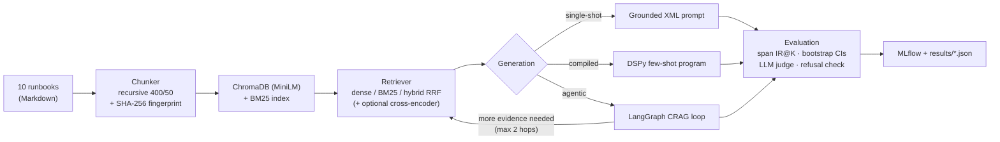
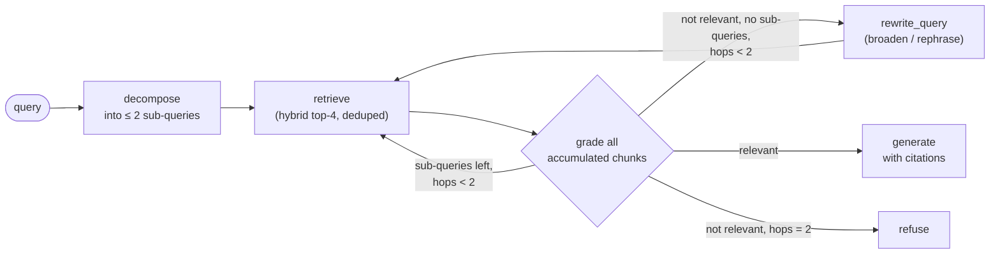

# rag-eval-harness

[](https://github.com/adityavsb/rag-eval-harness/actions/workflows/ci.yml)
[](pyproject.toml)
[](LICENSE)

A benchmark for answering questions from engineering runbooks, plus the evaluation code to go with it. I built it to measure which parts of a retrieval-augmented generation (RAG) system actually make answers better (chunking, hybrid search, reranking, prompt compilation, an agentic retrieval loop) and which only look better because of how they're measured.

The short version: most of the work went into finding out that my own early numbers were wrong. Fixing the measurement mattered more than any retrieval trick.

**Stack:** Python · Pydantic · ChromaDB · sentence-transformers (bi-encoder + cross-encoder) · rank-bm25 · LangGraph · DSPy · LiteLLM / OpenRouter · MLflow · pytest · GitHub Actions

[Problem](#the-problem) · [Results](#what-i-found) · [Design](#how-it-works) · [Methodology](#how-its-measured) · [Iteration history](#how-the-numbers-changed) · [Limitations](#limitations-and-open-questions) · [Quickstart](#quickstart) · [ADRs](docs/decisions.md)

---

## The problem

Say a platform team wants an "ask the runbooks" assistant for onboarding and incident response. Getting a demo running takes an afternoon. Knowing whether it's safe to rely on is harder:

- **A wrong answer causes outages, not just a bad experience.** If the assistant makes up a token TTL or a rollback threshold, someone acts on it at 3 a.m. It has to cite the source and say "I don't know" when the runbooks don't cover the question.
- **The design choices interact.** Chunk size, lexical vs. semantic search, reranking, prompt style, and whether to do a second retrieval hop all change the outcome. Without a fixed benchmark, every change gets judged on a handful of hand-picked queries.

So this repo is the measuring stick: a fixed corpus, a labelled question set, and evaluation code that reports uncertainty instead of single numbers.

**What's in it:**

| | |
| :--- | :--- |
| **Corpus** | 10 runbooks I wrote for a fictional "Enterprise API Platform" (gateway, auth, caching, migrations, canary rollouts, …) |
| **Question set** | 80 hand-labelled questions: 44 single-fact, 17 multi-hop (answer spans two documents), 19 unanswerable traps. Split 32 / 16 / 32 into train / dev / held-out test |
| **Retrieval** | Dense (MiniLM + ChromaDB), BM25, hybrid Reciprocal Rank Fusion, optional cross-encoder reranking |
| **Generation** | Single-shot grounded prompt, DSPy-compiled few-shot program, LangGraph Corrective RAG loop |
| **Evaluation** | Span-overlap IR metrics, 2,000-resample bootstrap CIs, paired deltas + exact McNemar test, LLM judge through OpenRouter, MLflow tracking |

---

## What I found

All numbers come from committed JSON under [`results/`](results/). Retrieval metrics are averaged over the 61 answerable questions; refusal over the 19 unanswerable ones.

1. **Measurement bugs beat model choices.** My first run said a naive 1,000-character chunker got 12.5% Hit@4. It actually got 98.4%. The ground-truth labels were chunk IDs from a *different* chunker, so I was measuring whether chunk IDs lined up rather than whether retrieval worked. Moving to character-span labels fixed it ([details](#how-the-numbers-changed)).

2. **On a 65-chunk corpus, nothing in retrieval clearly beats plain dense search.** Cross-encoder reranking costs ~13× the P95 retrieval latency (4.5 ms → 60.3 ms) for +0.011 MRR, and the paired 95% CI includes zero. Hybrid BM25 + dense keeps latency at ~4.4 ms and matches exact identifiers better, but its Hit@4 difference from dense-only is one query (McNemar p = 1.00). I kept hybrid as the default because of how it behaves, not because the benchmark shows it winning.

3. **A token limit made a good model look like a hallucinator.** At `max_tokens: 500`, Qwen 3.7 Flash spent its budget on hidden reasoning and returned empty strings for 51 of 80 questions. Empty strings don't contain the refusal phrase, so it scored 31.6% refusal and 48% correctness. At 4,000 tokens: 0 empty outputs, 100% refusal, 83.5% correctness, basically tied with DeepSeek (84.0%). The real difference between the two is latency (P95 17.7 s vs 5.8 s).

4. **The `K = 8` control beat the agentic loop.** Adding query rewriting on failed hops pushed Corrective RAG from 84.0% (`K = 4`) to 87.8% (paired CI [+0.9, +7.6] pp; multi-hop +9.4 pp [+2.6, +17.9]). That looked like a clean win—until I ran the context-matched control. Single-shot hybrid at `K = 8` (same 8-chunk budget as 2-hop CRAG) scored **91.0% overall** and **78.8% on multi-hop** at about half the latency (6.1 s vs 11.2 s), with one generator call per question instead of up to five (decompose, grade, rewrite, grade, generate). On a 65-chunk corpus, the extra context did the work, not the agentic loop. The CRAG − K=8 gap (−3.2 pp, CI [−7.7, +0.1]) doesn't clearly exclude zero, so the fair reading is that CRAG is no better, not that it's worse.

5. **Prompt compilation helped a little, but only after its training contexts were fixed.** A mock LM once showed a "+53.9% DSPy gain" (the gain was literally in the mock's code). My first live compile gave just +0.5 pp on held-out data—and a bizarre 41.5% oracle score—because `compile.py` was still building train/dev/oracle contexts from legacy chunk IDs, giving the wrong passage on 29 of 37 train/dev and 20 of 24 test answerable questions. Resolving contexts from `ground_truth_spans` and scoring strictly on the 24 answerable test items fixed the inversion (oracle: 84.2% → 89.0%, +4.8 pp [−8.7, +17.6]) and lifted retrieved-context correctness from 75.4% to 79.0% (+3.6 pp [−3.0, +11.4]; multi-hop +9.9 pp [−8.7, +31.7] on n = 8). Both paired 95% CIs still cross zero at n = 24, so I read the lift as directional rather than conclusive.

**What I'd recommend for the runbook assistant:** single-shot hybrid retrieval at `K = 8` with no reranker and no agentic loop at this corpus size. Re-run both the reranker and CRAG comparisons once the corpus is large enough (hundreds of chunks) that top-8 stops covering secondary documents.

---

## How it works



| Component | Choice | Why |
| :--- | :--- | :--- |
| **Vector store** | In-process ChromaDB with a SHA-256 fingerprint of corpus + chunking config | Runs in CI without Docker or paid services. The fingerprint forces a rebuild when inputs change. I added it after finding a baseline that had been scored against a stale 5-document index. ([ADR 001](docs/decisions.md#adr-001-in-process-chromadb-vs-hosted-vector-databases--faiss)) |
| **Chunking** | Recursive character splitter, 400 chars / 50 overlap | Fixed 1,000-char chunks get higher span hit rate, but only because 4 of them cover ~20% of the corpus. 400/50 sends 2.5× less context per query. ([ADR 002](docs/decisions.md#adr-002-span-based-ground-truth--recursive-chunking-40050-vs-10000)) |
| **Retrieval** | BM25 + dense fused with RRF (k = 60); cross-encoder off by default | Runbooks are full of exact identifiers (`worker_prefetch_multiplier`, `lock_timeout`, `Retry-After`, HTTP 429) that embeddings blur. RRF needs no score calibration between the two retrievers. ([ADR 003](docs/decisions.md#adr-003-single-stage-hybrid-rrf-vs-cross-encoder-reranking)) |
| **Metrics** | Hand-written Hit@K, MRR@K, context precision/recall, bootstrap CIs, McNemar | I wanted every formula visible and unit-tested, with uncertainty on every number, instead of relying on a library's internal prompts. ([ADR 004](docs/decisions.md#adr-004-custom-deterministic-ir-math--bootstrap-uncertainty)) |
| **Judge** | One external model (`perplexity/pplx-decider-flash-v1.2`) scores every generator; no silent fallback | Generators never grade themselves. If the judge call fails, the run fails instead of quietly switching to a heuristic. That silent switch did happen once. ([ADR 005](docs/decisions.md#adr-005-separate-offline-wiring-guards-vs-live-llm-as-a-judge)) |
| **Agentic loop** | LangGraph state machine, at most 2 hops, with query rewrite on failed grading | Single-shot top-4 often fills all four slots from one document, so the second document a multi-hop question needs never shows up. It works, but a plain top-8 fixes the same problem more cheaply on this corpus, so it's kept as an option rather than the default. ([ADR 006](docs/decisions.md#adr-006-langgraph-corrective-rag-crag--reasoning-token-budgets)) |
| **Cost control** | SHA-256 disk cache for every LLM and judge call, per-query checkpoints | Interrupted live runs resume where they stopped, and re-scoring saved runs costs nothing. A full 80-question live sweep costs roughly €0.01–0.03. |

### The Corrective RAG loop



Source: [`src/pipeline/agentic_graph.py`](src/pipeline/agentic_graph.py). The grader looks at evidence from *every* hop (up to 8 deduplicated chunks), and if a single-part query fails grading, `rewrite_query` rephrases it before hop 2 instead of re-running the identical query.

---

## How it's measured

**Labels are character spans, not chunk IDs.** Each answerable question records which character ranges of which document contain the answer. A retrieved chunk counts as relevant if it overlaps at least 50% of a gold span. That way chunking strategies can be compared on the same labels.

**Answerable and unanswerable questions are scored separately.** IR metrics use the 61 answerable questions. The 19 trap questions are scored only on whether the model refuses. Before this split, the trap questions counted as automatic misses and capped Hit Rate at 76.25%.

**Refusal is an exact phrase.** The prompt tells the model to answer "insufficient information" when the context doesn't cover the question, and refusal is checked by string match. The judge isn't called for trap questions. This is strict on purpose (the assistant is supposed to use that wording), but it also means an empty or differently worded refusal counts as a failure. That's exactly how the Qwen token-limit bug showed up as "hallucination".

**Every comparison comes with a confidence interval.** 2,000 bootstrap resamples per metric. Comparisons between two configurations use paired bootstrap deltas on the same questions, plus an exact McNemar test for hit rate ([`scripts/compare_runs.py`](scripts/compare_runs.py)). With n = 61, a one-question difference is 1.6 pp, and the CIs make that obvious.

**Offline and live mode are separate, and the tables say which is which.**

> [!NOTE]
> In `--mode offline`, retrieval uses the real local models (MiniLM, BM25, cross-encoder), but generation is a **deterministic mock** that echoes the top chunk and the judge is a **lexical-overlap heuristic**. Offline mode is for fast, free CI regression tests and says nothing about any LLM. All generation-quality numbers below are from `--mode live`.

**The test split stays untouched during optimisation.** DSPy compiles on train (32) and dev (16) only, and nothing is tuned on the 32-question test split. To be precise, though, it has been *scored* three times (Nov 17, and twice on Nov 20) because each fix to the context bug needed a re-evaluation. No choice was made by looking at test results, but it's no longer a never-seen holdout. The live paradigm runs score all 80 questions because nothing is tuned in them.

---

## Results

### 1. Retrieval sweep (offline, real models, n = 61, K = 4)

| Metric | Fixed 1000/0 | Recursive 400/50 | Dense + cross-encoder | Hybrid RRF | Hybrid + cross-encoder | Δ Hybrid vs. recursive (95% CI) |
| :--- | :---: | :---: | :---: | :---: | :---: | :---: |
| **Hit@4** | 98.36% | 73.77% | 73.77% | 72.13% | 73.77% | −1.64 pp [−4.92, 0.00], McNemar p = 1.00 |
| **MRR@4** | 0.906 | 0.643 | 0.654 | 0.650 | 0.654 | +0.007 [−0.014, +0.033] |
| **Context precision@4** | 90.16% | 63.39% | 64.16% | 63.93% | 64.16% | +0.55 pp [−1.91, +3.42] |
| **Context recall@4** | 94.26% | 63.11% | 65.57% | 63.39% | 65.57% | +0.27 pp [−1.64, +2.46] |
| **P95 latency** | 5.9 ms | 4.5 ms | 60.3 ms | 4.4 ms | 61.2 ms | −0.1 ms |

The fixed 1000/0 column wins because it sends 4,000 characters per query (~20% of the corpus, 21 chunks in total). Recursive 400/50 sends ~1,600 characters out of 65 chunks. The 1000/0 column shows what happens when you retrieve a large slice of a small corpus, not a better retriever. Per-metric CIs: [`results/offline_retrieval_summary.json`](results/offline_retrieval_summary.json).

**Hybrid RRF saturation across `K` (`4, 6, 8, 12`, offline, n = 61):** Hit@K jumps at `K = 6` and plateaus; precision peaks at `K = 8` before dipping at `K = 12`, while multi-hop recall keeps rising at 3× the context volume. Source: [`results/k_sweep_retrieval_summary.json`](results/k_sweep_retrieval_summary.json).

| K | Corpus sent | Hit@K | MRR@K | Precision@K | Recall@K | Multi-hop recall@K | P95 latency |
| :---: | :---: | :---: | :---: | :---: | :---: | :---: | :---: |
| 4 | 6.2% (~1.6k chars) | 72.13% | 0.650 | 63.93% | 63.39% | 59.80% | 5.7 ms |
| 6 | 9.2% (~2.4k chars) | 77.05% | 0.655 | 64.40% | 66.12% | 69.61% | 5.0 ms |
| 8 | 12.3% (~3.2k chars) | 77.05% | 0.657 | **64.57%** | 66.12% | 69.61% | 5.2 ms |
| 12 | 18.5% (~4.8k chars) | 77.05% | 0.655 | 63.61% | **69.40%** | **78.43%** | 6.3 ms |

### 2. Same retrieval, two generators (live)

Both models get the same hybrid top-4 context (`max_tokens: 4000`, 0/80 empty outputs) and are scored by the same judge. Source: [`results/openrouter_cohort_summary.json`](results/openrouter_cohort_summary.json).

| Generator | Single-fact (n=44) | Multi-hop (n=17) | Refusal (n=19) | Faithfulness (n=61) | Correctness (n=61) | P95 latency |
| :--- | :---: | :---: | :---: | :---: | :---: | :---: |
| `deepseek/deepseek-v4.1-flash` | 90.6% | 66.9% | 100% | 97.5% | 84.0% | 5.8 s |
| `qwen/qwen3.7-flash` | 89.5% | 67.8% | 100% | 97.4% | 83.5% | 17.7 s |

### 3. Single-shot (`K = 4` vs. `K = 8` control) vs. Corrective RAG (live)

All three rows use identical generator (`deepseek/deepseek-v4.1-flash`, `max_tokens: 4000`), judge (`perplexity/pplx-decider-flash-v1.2`), and commit (`22edfc7`). Sources: [`results/openrouter_cohort_summary.json`](results/openrouter_cohort_summary.json), [`results/hybrid_k8_summary.json`](results/hybrid_k8_summary.json), [`results/agentic_crag_summary.json`](results/agentic_crag_summary.json), [`results/paradigm_comparison.md`](results/paradigm_comparison.md).

| | Single-fact (n=44) | Multi-hop (n=17) | Multi-hop recall (all hops) | Refusal (n=19) | Correctness (n=61) | P95 latency |
| :--- | :---: | :---: | :---: | :---: | :---: | :---: |
| **Single-shot hybrid (`K = 4`)** | 90.6% | 66.9% | 59.8% | 100% | 84.0% | 5.8 s |
| **LangGraph CRAG (≤ 2 hops)** | 92.3% | 76.3% | 66.7% | 100% | 87.8% | 11.2 s |
| **Single-shot hybrid (`K = 8` control)** | **95.7%** | **78.8%** | **69.6%** | **100%** | **91.0%** | **6.1 s** |
| *Paired Δ: CRAG vs. K = 4 (95% CI)* | +1.7 pp [−0.5, +5.4] | +9.4 pp [+2.6, +17.9] | +6.9 pp | 0 | +3.8 pp [+0.9, +7.6] | 1.9× |
| *Paired Δ: K = 8 vs. K = 4 (95% CI)* | +5.1 pp [+0.2, +11.1] | +12.0 pp [+4.7, +20.9] | +9.8 pp | 0 | **+7.0 pp [+2.8, +12.1]** | 1.05× |
| *Paired Δ: CRAG vs. K = 8 (95% CI)* | −3.4 pp [−9.3, +0.7] | −2.6 pp [−5.7, +0.2] | −2.9 pp | 0 | −3.2 pp [−7.7, +0.1] | 1.8× |

### 4. DSPy compilation on the held-out test split (live, n = 24 answerable / n = 8 traps)

`BootstrapFewShotWithRandomSearch` on train/dev (contexts resolved from `ground_truth_spans`), scored on the quarantined test split under both oracle spans and hybrid top-4 retrieval. Correctness and faithfulness average strictly over the 24 answerable test items, matching the n = 61 tables above. Source: [`results/dspy_openrouter_summary.json`](results/dspy_openrouter_summary.json).

| Program | Correctness (n=24) | Multi-hop (n=8) | Refusal (n=8) | Faithfulness (n=24) |
| :--- | :---: | :---: | :---: | :---: |
| Zero-shot (oracle spans) | 84.2% | 59.5% | 100% | 96.1% |
| Compiled, 4 demos (oracle spans)\* | 89.0% | 85.4% | 100% | 94.4% |
| *Paired Δ: oracle (95% CI)* | +4.8 pp [−8.7, +17.6] | +25.9 pp [−0.1, +52.3] | 0 | −1.8 pp |
| Zero-shot (retrieved top-4) | 75.4% | 53.2% | 100% | 94.4% |
| Compiled, 4 demos (retrieved top-4) | **79.0%** | **63.1%** | 100% | **96.2%** |
| *Paired Δ: retrieved (95% CI)* | +3.6 pp [−3.0, +11.4] | +9.9 pp [−8.7, +31.7] | 0 | +1.8 pp |

*\*`compiled_oracle` had 1/24 `AdapterParseError` scored as 0.0 faithfulness and correctness (explaining the 94.4% faithfulness); both retrieved arms had 0 parse failures. Paired CIs come from 2,000 bootstrap resamples over per-question scores saved locally in `reports/live/dspy-compiled-rag/compile_summary.json`.*

<details>
<summary><strong>Offline judge regression guard and benchmark environment</strong></summary>

The offline lexical judge is checked against 30 probe labels I wrote ([`data/human_labels.jsonl`](data/human_labels.jsonl)). The heuristic's thresholds were set while looking at those same labels, so this is an in-sample regression guard that catches the heuristic drifting. It isn't calibration evidence for the live judge.

| Check | Observed | 95% CI |
| :--- | :---: | :---: |
| Faithfulness raw agreement | 83.3% | — |
| Faithfulness Cohen's κ | 0.667 | [0.40, 0.93] |
| Correctness Spearman ρ | 0.872 | [0.77, 0.93] |

Environment (captured in every report's `environment` key): macOS 27.0.1 arm64, Python 3.13.6, chromadb 1.5.9, sentence-transformers 6.1.0, langgraph 1.2.16, dspy 3.4.1, mlflow 3.17.2, rank-bm25 0.2.2, torch 2.14.1.

</details>

---

## How the numbers changed

The project ran from 2026-10-21 to 2026-11-20. Most of that month went into finding out which results were real. This table is the condensed version: what I believed, what was actually going on, and what changed.

| Believed → fixed | What the numbers said | What was actually going on | What changed |
| :--- | :--- | :--- | :--- |
| Oct 21 → Oct 27 | Naive 1000/0 baseline: **12.5% Hit@4**; 400/50 chunking "+1069%" better | Gold labels were chunk IDs from the 400-char chunker, so most of them couldn't exist under 1000/0. The baseline had also been scored against a stale 5-document index | Migrated labels to character spans with ≥50% overlap matching. Added a corpus/config fingerprint that forces re-indexing. Baseline is really **98.4%** |
| Oct 21 → Oct 27 | Hit Rate capped at exactly **76.25%** | 19 unanswerable questions were in the denominator as automatic misses (61/80 = 76.25%) | IR metrics use n = 61 answerable questions; refusal is tracked separately on n = 19 |
| Oct 21 → Oct 27 | "Recursive 400/50" chunker | The splitter neither recursed nor enforced the size limit: 30 of 42 chunks were over 400 chars (max 819) and 26 started mid-word | Rewrote the splitter with a test that checks size and word boundaries. Chunk count went from 42 to 65 |
| Oct 25 → Oct 27 | DSPy compilation: **0% → 53.9%** correctness | The offline mock LM produced a truncated answer whenever no demos were present. The gain was a branch in the mock | Made the mock ignore demos (there's a test for it). Offline DSPy is now a wiring smoke test only |
| Oct 24 → Oct 27 | Judge "calibration": κ = 0.667 | The heuristic's thresholds were tuned in the same commit as the 30 labels it was scored against | Relabelled as an in-sample regression guard with CIs. Live scoring moved to an external judge model |
| Oct 29 → Oct 29 | First live judged runs | The decision-model judge was sent to the chat endpoint, failed, and **silently fell back** to the lexical heuristic | Routed it to the native `/api/alpha/decisions` endpoint, removed all silent fallbacks, re-scored the saved outputs |
| Oct 29 → Nov 20 | Qwen: **31.6% refusal, 48% correctness**. CRAG: **+15.5 pp** on multi-hop | `max_tokens: 500` let reasoning traces eat the whole budget, producing empty answers (51/80 Qwen, 11/80 DeepSeek, 7/80 CRAG). The disk cache had also stored those empty responses, so reruns replayed them | Raised the cap to 4,000, stopped caching empty responses, and added an `empty_answer_count` metric to every report; published runs show 0 |
| Nov 2 → Nov 20 | CRAG multi-hop gains | The grader only looked at `chunks[:4]`, which are always hop-1 chunks, so hop-2 evidence was never graded | Grader now sees up to 8 accumulated chunks, with a test that checks hop-2 chunks reach it. CRAG gain dropped to +4.3 pp (CI crosses 0) |
| Nov 2 → Nov 17 | Published DSPy row: 58.8% multi-hop, 15.8% refusal | That row came from the offline mock. The live DSPy path only built an `openai/` client, so OpenRouter never reached DSPy, and the saved program had `demos: []` | Routed DSPy through LiteLLM → OpenRouter. Fixed a reasoning-truncation abort and a strict JSON-adapter retry with a lenient adapter. Withdrew the row and published the held-out result (+0.5 pp) |
| Nov 17 → Nov 20 | DSPy oracle correctness **41.5%** (below retrieved 81.5%); compiled lift +0.5 pp | `compile.py` built train/dev/oracle contexts from legacy `ground_truth_context_ids` (mismatching 29/37 train/dev and 20/24 test items), and mixed 8 traps into the 32-item correctness denominator | Resolved DSPy contexts from `ground_truth_spans`, restricted correctness/faithfulness to n = 24 answerable items, and re-evaluated: oracle **84.2% → 89.0%**, retrieved **75.4% → 79.0%** (+9.9 pp multi-hop) |
| Nov 20 → Nov 20 | CRAG beats `K = 4` (+3.8 pp with query rewrite); JSONs recorded `bb48ee3` | Earlier runs happened on uncommitted edits, hop 2 repeated the same query on failed single-part grading, and CRAG's 8-chunk budget lacked a `K = 8` single-shot control | Added `rewrite_query` node, `-dirty` git SHA guard, and `configs/hybrid_k8.yaml`; re-ran everything on clean commit `22edfc7`. Single-shot `K = 8` scored **91.0%** vs. CRAG's **87.8%** at nearly half the latency |

Along the way I also took full per-query traces out of git history (they contained generated answers and retrieved context), kept only aggregate JSON in [`results/`](results/), and added [`results/live_run_lineage.json`](results/live_run_lineage.json) to record which runs were superseded and why.

**What I'd do differently:** put span-based labels and a fingerprinted index in place before running anything. Read a sample of raw outputs before looking at aggregates; every bug above was obvious in the raw JSON and invisible in the summary table. Make every fallback path loud from day one. And before building the complex version of something, run the cheapest baseline that gets the same resources. The K = 8 control took one config file, and it answered the question the whole LangGraph pipeline was built to answer.

---

## Limitations and open questions

These are known, not hidden. Several are what I'd fix next.

- **Small corpus.** 65 chunks is small enough that a `K = 8` window already covers ~12% of the entire corpus—which is why single-shot `K = 8` beat CRAG here. Reranking and agentic loops may pay off on a corpus 10× larger; this benchmark can't show that either way.
- **K wasn't swept.** I picked 8 to match CRAG's context budget and evaluated it on the same 80 questions. Whether 6 or 12 would do better, and where extra context starts adding noise, is untested.
- **The DSPy evidence is thin.** The compiled program uses 4 demos (3 single-fact, 1 refusal, none multi-hop), and the multi-hop arm has 8 questions. The published holdout was also replayed from DSPy's response cache, so its latency and cost fields (~1–3 ms, €0) don't mean anything.
- **Coarse document grading.** The CRAG grader makes one yes/no decision on the whole accumulated chunk set rather than filtering out individual irrelevant chunks before generation.
- **The labels have one author.** The corpus, the 80 questions, and the 30 probe labels are all mine. There's no inter-annotator agreement, and the live judge hasn't been validated against human labels on live outputs.
- **The judge is a single model.** Using one judge for all generators keeps comparisons fair, but any bias in that judge carries into every table.
- **Only the retrieval sweep is reproducible offline.** The live numbers need an OpenRouter key and depend on hosted model versions that can change.

---

## How I worked

I used AI coding assistants for much of the implementation. The direction, the dataset, and the decision about what to believe were mine:

- **I wrote the corpus and every label.** All 10 runbooks, 80 questions with character spans, and the probe labels ([dataset card](data/README.md)).
- **I reviewed the project against itself.** After the first week I ran a structured review of the repo in four parts: evaluation logic, methodology, factual claims and citations, and repo hygiene. It rated the project 3.5/10 and found most of the October 21–27 problems in the table above. I fixed those before adding any new features.
- **I treated surprising numbers as bugs until shown otherwise.** The Qwen "hallucinations", the CRAG +15.5 pp, and the DSPy +53.9% were all improvements I wanted to be true, and all of them turned out to be measurement errors. When CRAG finally showed a gain whose CI excluded zero, I ran the context-matched control before believing it, and the control won.
- **I kept a decision record.** Architecture decisions are in [docs/decisions.md](docs/decisions.md), superseded runs are in [`results/live_run_lineage.json`](results/live_run_lineage.json), and claims that turned out wrong are withdrawn in the open rather than quietly edited away.
- **I added tests for the bugs I found.** The hop-2 grader, the query rewrite on failed grading, span-resolved DSPy contexts, the `-dirty` commit marker on reports, the demo-agnostic mock, chunk size bounds, provider error redaction, and the README's own offline-mode disclosure each have one, so they can't come back unnoticed.

---

## What's next

1. Scale the corpus to 50+ documents and 500+ chunks, then re-run the reranker, `K = 8`, and CRAG comparisons where candidates actually compete.
2. Sweep K (4, 6, 8, 12) for single-shot hybrid to find where extra context stops helping.
3. Paired bootstrap CIs for the DSPy compiled-vs-zero-shot deltas, from saved per-question scores.
4. Per-chunk relevance filtering in the CRAG grader instead of a single pass/fail decision on the whole set.
5. A second annotator on a sample of live outputs, to measure how well the judge agrees with people.

---

## Quickstart

### Install and test (no API key)

```bash
git clone https://github.com/adityavsb/rag-eval-harness.git
cd rag-eval-harness
make install
make test
```

72 tests run offline (~15 s warm, ~40 s cold while the models download).

### Offline retrieval benchmarks

```bash
# all 5 retrieval configs
make eval-all

# refresh results/offline_retrieval_summary.json
.venv/bin/python scripts/generate_paradigm_table.py --export-offline

# paired bootstrap CI + McNemar between two local runs
.venv/bin/python scripts/compare_runs.py \
  reports/offline/chunk-optimized-rag/latest.json \
  reports/offline/hybrid-rrf-rag/latest.json --markdown

# ask one question
.venv/bin/python experiments/run_pipeline.py --config configs/hybrid.yaml \
  --query "What is the token expiration period for short-lived access tokens?"
```

### Live evaluation (OpenRouter)

Put `OPENROUTER_API_KEY=...` in a local `.env` at the repo root (gitignored).

```bash
# smoke test: one question
.venv/bin/python experiments/run_eval.py --config configs/openrouter_cohort.yaml --mode live --stage check-one

# full 80-question runs: single-shot vs. CRAG
.venv/bin/python experiments/run_eval.py --config configs/openrouter_cohort.yaml --mode live --stage full --model deepseek/deepseek-v4.1-flash
.venv/bin/python experiments/run_eval.py --config configs/agentic_crag.yaml --mode live --stage full --model deepseek/deepseek-v4.1-flash

# DSPy: compile on train/dev, then score the held-out test split
.venv/bin/python src/optimize/compile.py --mode live --model deepseek/deepseek-v4.1-flash
.venv/bin/python src/optimize/compile.py --mode live --eval-only --model deepseek/deepseek-v4.1-flash

# MLflow UI at http://localhost:5001
make mlflow
```

---

## Repository layout

```text
configs/        YAML configs per experiment (baseline, chunking, rerank, hybrid, hybrid_k8, agentic_crag, dspy_live, openrouter_cohort)
data/           10 runbooks, 80-question golden set with spans and splits, probe labels, dataset card
docs/           Architecture decision records (ADR 001–006)
results/        Committed aggregate metrics behind every README table, plus run lineage
reports/        Full per-query traces (local only, gitignored)
src/pipeline/   ingestion, indexing, retriever (dense/BM25/RRF/rerank), generator, agentic_graph
src/eval/       retrieval metrics, LLM judge, judge agreement, runner (bootstrap CIs)
src/llm/        LiteLLM/OpenRouter provider, SHA-256 response cache, EUR pricing
src/optimize/   DSPy program and compile script
experiments/    CLI entry points (run_eval, run_pipeline)
scripts/        compare_runs, sweep_k, generate_paradigm_table, rejudge_saved_reports, dataset_card, …
tests/          72 offline tests; CI on Python 3.11–3.13
```

---

## References

- Cormack, Clarke & Büttcher (2009). Reciprocal rank fusion outperforms Condorcet and individual rank learning methods. *SIGIR*. https://doi.org/10.1145/1571941.1572114
- Robertson & Zaragoza (2009). The Probabilistic Relevance Framework: BM25 and Beyond. *FnTIR* 3(4). https://doi.org/10.1561/1500000019
- Reimers & Gurevych (2019). Sentence-BERT. *EMNLP-IJCNLP*. https://doi.org/10.18653/v1/D19-1410
- Khattab et al. (2023). DSPy: Compiling Declarative Language Model Calls into Self-Improving Pipelines. arXiv:2310.03714
- Yan et al. (2024). Corrective Retrieval Augmented Generation. arXiv:2401.15884
- Es et al. (2024). RAGAs: Automated Evaluation of Retrieval Augmented Generation. *EACL demo*. https://doi.org/10.18653/v1/2024.eacl-demo.16
- Cohen (1960). A Coefficient of Agreement for Nominal Scales. https://doi.org/10.1177/001316446002000104
- Landis & Koch (1977). The Measurement of Observer Agreement for Categorical Data. https://doi.org/10.2307/2529310

## License

MIT, see [LICENSE](LICENSE). Third-party packages and model weights: [THIRD_PARTY_NOTICES.md](THIRD_PARTY_NOTICES.md).
